# Company Bankruptcy Prediction

**Zhankai Zhang** · Boston University, Questrom School of Business
Advanced Machine Learning (MF815) · 18 March 2026


## Abstract

This project develops a corporate bankruptcy prediction model using **95 financial ratio features**
from the Taiwan Economic Journal, addressing an extremely imbalanced dataset in which only **3% of the
5,455 training samples represent bankrupt firms**. Five classification methods — Random Forest,
XGBoost, LightGBM, CatBoost, and Logistic Regression — were systematically evaluated, with Bayesian
hyperparameter optimisation conducted via a **200-trial Optuna** search. XGBoost achieved the strongest
baseline performance, with **AUC 0.9625** and competitive minority-class F1. After incorporating an
**ECOD**-based outlier detection feature, the tuned XGBoost model improved the validation F1 to
**0.5060**, demonstrating enhanced capability in identifying rare default cases.

Although additional techniques such as **SMOTE** oversampling, **focal loss**, model **stacking**
(XGBoost + LightGBM + CatBoost), and probability averaging were explored, none delivered further gains,
largely due to overfitting or limited model diversity. The final submission employed full-data
retraining, removal of highly collinear features, and multi-seed prediction averaging, achieving an
**OOF F1 of 0.4988** and predicting a **4.03% bankruptcy rate** on the test set. These results highlight
the importance of imbalance-aware optimisation and targeted feature engineering in rare-event financial
risk modelling.

---

## 1. Results

**The deliverable is XGBoost (tuned + ECOD) at Val F1 = 0.5060 on the bankrupt class.** Three findings
matter more than that number:

1. **Threshold optimisation is the single largest lever** — worth **10–20 F1 points** over the default
   0.5 cutoff, more than hyperparameter tuning and feature engineering combined.
2. **Every resampling variant lost to built-in class weighting.** SMOTE, SMOTE-ENN and SMOTE-Tomek each
   *raised* cross-validated F1 while *lowering* validation F1 — the inflation Kuhn & Johnson describe.
3. **Complexity stopped paying early.** Focal loss, RFECV, and a rank-normalised stacking ensemble of
   XGBoost + LightGBM + CatBoost all underperformed the single tuned model.

### Best model per family

| Model family | Model | Accuracy | F1 (Class 0) | **F1 (Class 1)** | AUC-ROC |
|---|---|---|---|---|---|
| **XGBoost** | XGB (tuned + ECOD) | 0.9624 | 0.9805 | **0.5060** | 0.9627 |
| LightGBM | LGBM (tuned) | **0.9707** | **0.9849** | 0.4483 | 0.9605 |
| Logistic Reg. | LR (all features) | 0.9569 | 0.9776 | 0.4337 | 0.9155 |
| CatBoost | CatBoost (tuned) | 0.9633 | 0.9811 | 0.4286 | **0.9638** |
| Random Forest | RF (all features) | 0.9615 | 0.9801 | 0.4167 | 0.9487 |

*Figure 6: best model per type*

> **The choice of metric decides the winner.** CatBoost has the best AUC-ROC (0.9638) and LightGBM the
> best accuracy (0.9707) and class-0 F1 (0.9849). Only on **minority-class F1** does XGBoost + ECOD lead.
> With a 3.12% positive rate, accuracy and class-0 F1 are dominated by the majority class — a model that
> predicts "never bankrupt" scores 96.88% accuracy for free. Minority-class F1 is therefore the selection
> metric throughout this report.

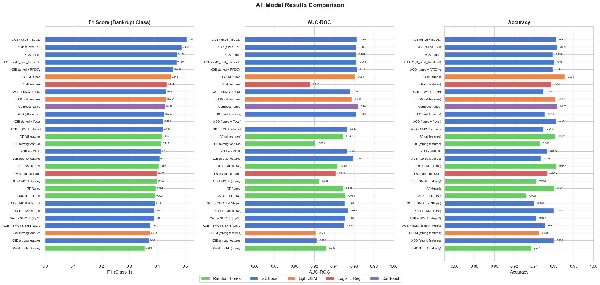
*Figure 7: all 29 configurations — F1 (bankrupt class), AUC-ROC, and accuracy, coloured by model family*

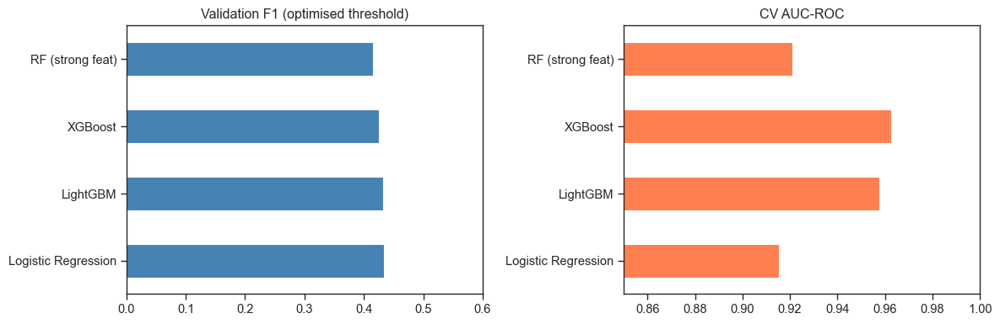
*Before tuning: validation F1 (threshold-optimised) and CV AUC-ROC across the four baseline models*

### All 29 configurations

Sorted by F1 on the bankrupt class:

| # | Model type | Approach | Model | Accuracy | F1 (0) | **F1 (1)** | AUC-ROC | Threshold |
|---|---|---|---|---|---|---|---|---|
| 0 | XGBoost | Tuned + ECOD | XGB (tuned + ECOD) | 0.9624 | 0.9805 | **0.5060** | 0.9627 | 0.4972 |
| 1 | XGBoost | Tuned + Yeo-Johnson | XGB (tuned + YJ) | 0.9633 | 0.9810 | 0.4872 | 0.9619 | 0.6267 |
| 2 | XGBoost | Optuna tuned | XGB (tuned) | 0.9588 | 0.9785 | 0.4706 | 0.9618 | 0.4744 |
| 3 | XGBoost | Re-tuned (v2) | XGB v2 (f1_best_threshold) | 0.9606 | 0.9795 | 0.4691 | 0.9625 | 0.6244 |
| 4 | XGBoost | Tuned + RFECV | XGB (tuned + RFECV) | 0.9588 | 0.9786 | 0.4578 | 0.9629 | 0.5678 |
| 5 | LightGBM | Optuna tuned | LGBM (tuned) | 0.9707 | 0.9849 | 0.4483 | 0.9605 | 0.7259 |
| 6 | Logistic Reg. | Baseline | LR (all features) | 0.9569 | 0.9776 | 0.4337 | 0.9155 | 0.9171 |
| 7 | XGBoost | Tuned + ECOD + SMOTE | XGB + SMOTE-ENN | 0.9496 | 0.9736 | 0.4330 | 0.9558 | 0.9627 |
| 8 | LightGBM | Baseline | LGBM (all features) | 0.9615 | 0.9801 | 0.4324 | 0.9578 | 0.2329 |
| 9 | CatBoost | Optuna tuned | CatBoost (tuned) | 0.9633 | 0.9811 | 0.4286 | 0.9638 | 0.6370 |
| 10 | XGBoost | Baseline | XGB (all features) | 0.9505 | 0.9741 | 0.4255 | 0.9625 | 0.0675 |
| 11 | XGBoost | Tuned + Focal Loss | XGB (tuned + Focal) | 0.9624 | 0.9806 | 0.4225 | — | 0.2951 |
| 12 | XGBoost | Tuned + ECOD + SMOTE | XGB + SMOTE-Tomek | 0.9496 | 0.9736 | 0.4211 | 0.9529 | 0.8955 |
| 13 | Random Forest | Baseline | RF (all features) | 0.9615 | 0.9801 | 0.4167 | 0.9487 | 0.2467 |
| 14 | Random Forest | Baseline | RF (strong features) | 0.9459 | 0.9716 | 0.4158 | 0.9210 | 0.1267 |
| 15 | XGBoost | Tuned + ECOD + SMOTE | XGB + SMOTE | 0.9533 | 0.9757 | 0.4138 | 0.9526 | 0.9273 |
| 16 | XGBoost | Baseline (top-30) | XGB (top 30 features) | 0.9468 | 0.9722 | 0.4082 | 0.9588 | 0.0645 |
| 17 | Random Forest | Baseline + SMOTE | RF + SMOTE (all) | 0.9624 | 0.9806 | 0.4058 | 0.9432 | 0.2600 |
| 18 | Random Forest | Baseline + SMOTE | RF + SMOTE (strong) | 0.9423 | 0.9697 | 0.4000 | 0.9248 | 0.1200 |
| 19 | Logistic Reg. | Baseline | LR (strong features) | 0.9533 | 0.9757 | 0.4000 | 0.9413 | 0.8727 |
| 20 | Random Forest | Optuna tuned | RF (tuned) | 0.9606 | 0.9796 | 0.3944 | 0.9489 | 0.5593 |
| 21 | Random Forest | Baseline + SMOTE | SMOTE + RF (all) | 0.9322 | 0.9641 | 0.3934 | 0.9513 | 0.3467 |
| 22 | XGBoost | Baseline + SMOTE | XGB + SMOTE-ENN (all) | 0.9404 | 0.9687 | 0.3925 | 0.9506 | 0.7591 |
| 23 | XGBoost | Baseline + SMOTE | XGB + SMOTE (all) | 0.9597 | 0.9791 | 0.3889 | 0.9541 | 0.9254 |
| 24 | XGBoost | Baseline + SMOTE (top-30) | XGB + SMOTE (top-30) | 0.9423 | 0.9697 | 0.3883 | 0.9508 | 0.3893 |
| 25 | XGBoost | Baseline + SMOTE (top-30) | XGB + SMOTE-ENN (top-30) | 0.9514 | 0.9747 | 0.3765 | 0.9500 | 0.9970 |
| 26 | LightGBM | Baseline | LGBM (strong features) | 0.9450 | 0.9712 | 0.3750 | 0.9211 | 0.1075 |
| 27 | XGBoost | Baseline | XGB (strong features) | 0.9597 | 0.9792 | 0.3714 | 0.9222 | 0.3269 |
| 28 | Random Forest | Baseline + SMOTE | SMOTE + RF (strong) | 0.9368 | 0.9667 | 0.3551 | 0.9316 | 0.4067 |

*Figure 5: all model results*

---

## 2. Best model selection: XGBoost (tuned + ECOD), Val F1 = 0.5060

The modelling process followed a sequential workflow beginning with baseline model comparison. Initial
experiments included Random Forest, LightGBM, XGBoost, and Logistic Regression. Following the
recommendation from *Applied Predictive Modeling* (Kuhn & Johnson, Ch. 16), model comparison was first
conducted using **AUC-ROC**, after which the classification **threshold was optimised to maximise the F1
score for the minority class**. Among the baseline models, XGBoost achieved the highest AUC-ROC (0.9625)
while maintaining a strong validation F1 (0.4255), and was selected as the primary baseline for
subsequent experimentation.

Several imbalance-handling and feature selection methods were then tested, including multiple SMOTE-based
resampling strategies and feature subset experiments. **None of these approaches improved validation
performance relative to the baseline** (§3.2.1), so the baseline XGBoost model was retained as the
foundation for further optimisation.

Next, hyperparameter tuning was performed using Optuna with the TPE sampler, resulting in **XGBoost
(tuned) with a Val F1 of 0.4706**. Building on this, several additional techniques were evaluated: ECOD
outlier detection, Yeo–Johnson transformation, RFECV, and focal loss. Among these, **ECOD feature
engineering produced the largest improvement**, increasing the Val F1 to **0.5060** — the best-performing
single model.

### Stacking ensemble

After identifying the best individual model, a stacking ensemble architecture was explored. To ensure
fairness among base learners, all models were retrained on the same feature space including the
ECOD-generated outlier feature; LightGBM (200 trials), Random Forest (50 trials), and CatBoost (100
trials) were re-tuned with Optuna and 5-fold stratified CV on the ECOD-augmented training set (91
features).

- **First layer (base learners):** XGBoost, LightGBM, CatBoost — each producing out-of-fold probability
  predictions via 5-fold StratifiedKFold.
- **Second layer (meta-learner):** Logistic Regression, applied to **rank-normalised** OOF probabilities
  to remove scale differences between model outputs.

| Model | Val F1 |
|---|---|
| XGBoost (tuned + ECOD) | **0.5060** |
| LightGBM (tuned + ECOD) | 0.4483 |
| RF (tuned + ECOD) | 0.3944 |
| CatBoost (tuned + ECOD) | 0.4286 |
| Stacking XGB + LGBM + CAT (rank-norm) | 0.4828 |

*Figure 8: stacking models*

Despite the additional stacking experiments, **the ensemble did not outperform the best individual
model**. The three gradient boosting models produce highly correlated predictions, limiting diversity
gain. XGBoost (tuned + ECOD) remained the strongest performer and was selected as the final model.

### Final submission pipeline

- Removed **11 highly collinear features** (|r| > 0.95): 89 → 78 features
- Added the ECOD `Is_outlier` feature (`contamination = 0.05`) → **79 features**; 273/5,455 train and
  89/1,364 test samples flagged
- Retrained on the full training set (5,455 samples) with **10 random seeds**, averaging predictions
- Applied the OOF-derived threshold **0.6004**; **OOF F1 = 0.4988** on the full training set
- Test predictions: **55 / 1,364 flagged bankrupt (4.03%)**, against a 3.12% training base rate

---

## 3. Methods

### 3.1 Model selection logic — XGBoost, Random Forest, LightGBM, Logistic Regression

The selection of models is primarily motivated by findings from the EDA, which revealed three key
characteristics of the dataset: **nonlinear relationships, extreme outliers, and severe class
imbalance**. These correspond to the strengths of the selected models: **XGBoost** (nonlinearity and
imbalance handling), **Random Forest** (robustness and bagging diversity), **LightGBM**, and **Logistic
Regression** (linear baseline for comparison).

**Nonlinearity.** The **Predictive Power Score** (PPS) was used to detect nonlinear predictive
relationships that Pearson correlation does not capture (Wetschoreck et al., 2020). Several features
show nonlinear signal with respect to the bankruptcy outcome — *Net Value Growth Rate* has a PPS of
**0.11 while its Pearson correlation is approximately zero** — indicating relationships that require
nonlinear modelling approaches. This observation motivated the use of **tree-based models**.

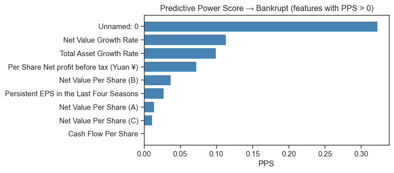
*Figure 1: Predictive Power Score → Bankrupt (features with PPS > 0)*

> The `Unnamed: 0` index column tops the PPS ranking, which is a **leakage signal rather than a
> predictor**. Its class distribution was inspected directly and the column was dropped before modelling:
>
> 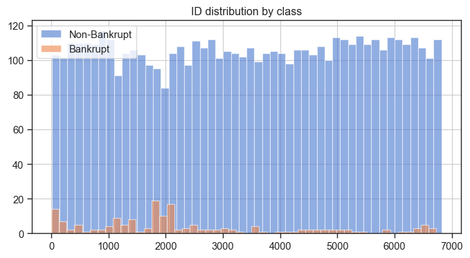

**Severe class imbalance.** The target has a **97/3 distribution** between non-bankrupt and bankrupt
firms. Tree-based models provide several mechanisms to address this: Random Forest through
`class_weight='balanced_subsample'` (Kuhn & Johnson, Ch. 16), XGBoost by incorporating imbalance
directly in the loss function via `scale_pos_weight`, and LightGBM via `is_unbalance=True`. Other
imbalance-handling techniques — SMOTE and threshold adjustment — are discussed in §3.2.

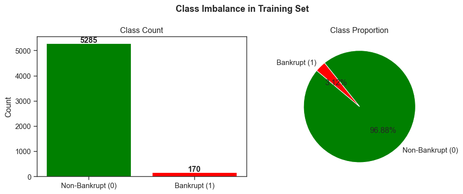
*Figure 2: Target Analysis — 5,285 non-bankrupt vs 170 bankrupt*

**Missing values and extreme outliers.** The dataset contains **21 columns with missing values**,
resulting from converting certain **sentinel values** to `NaN` during preprocessing, as well as extreme
outliers. XGBoost natively supports missing values during tree construction, while Random Forest is
inherently robust to outliers because tree-based splits are generally unaffected by extreme values.

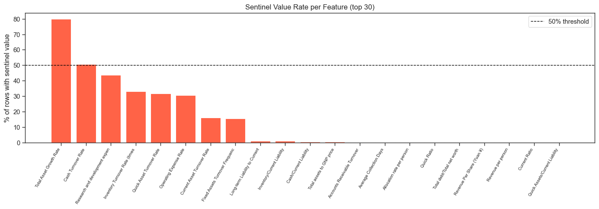
*Figure 3: Sentinel Value Analysis — share of sentinel-coded rows per feature (top 30)*

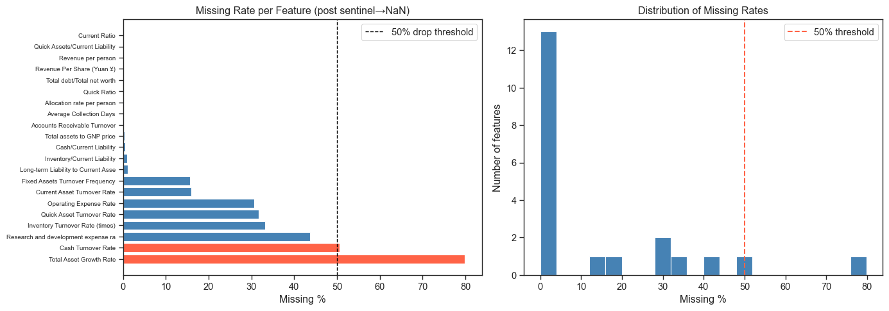
*Missing rate per column, with the 50% drop threshold marked in red*

**Multicollinearity.** In XGBoost, the combination of **L1/L2 regularisation** and feature subsampling
(`colsample_bytree`) helps mitigate the impact of redundant features. For Logistic Regression, highly
collinear variables were removed during preprocessing. This is particularly relevant because the dataset
contains **over 90 features, many of which are highly correlated financial ratios**.

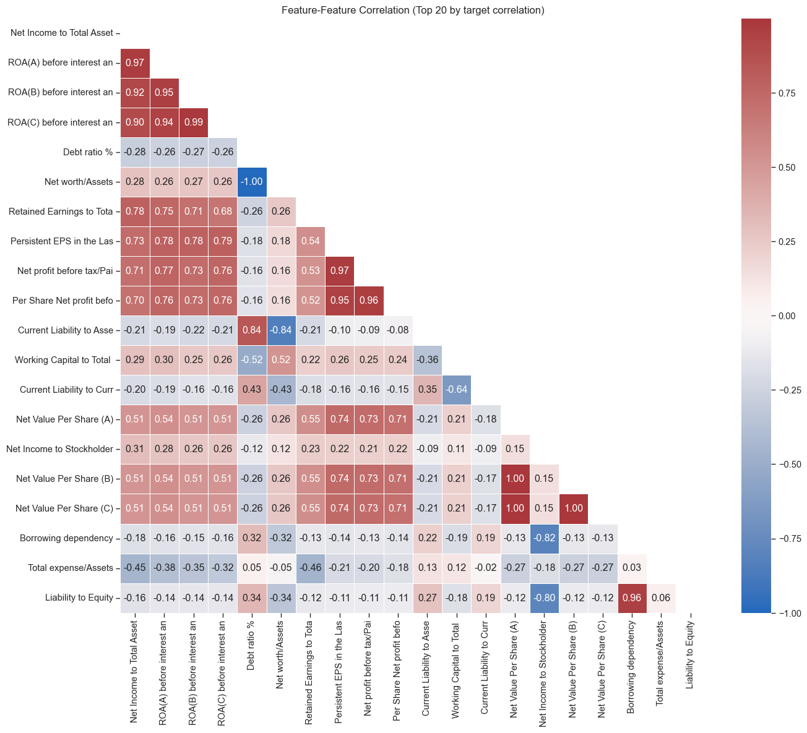
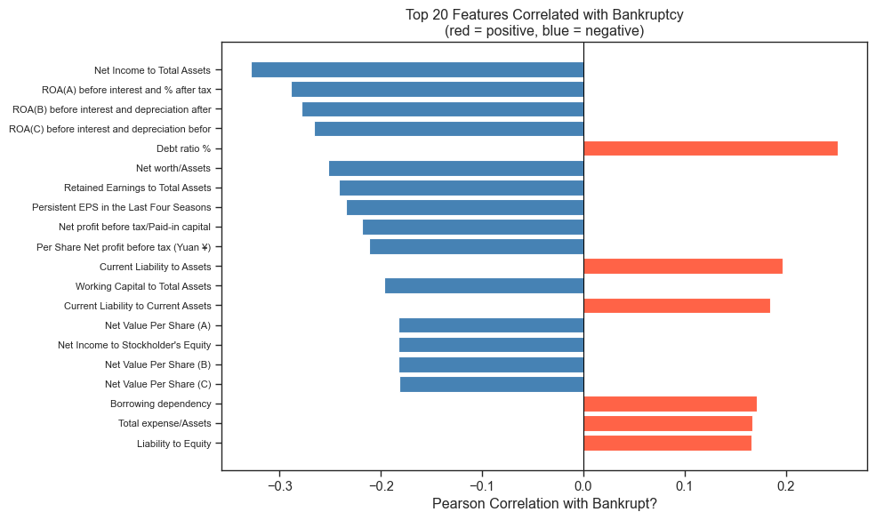
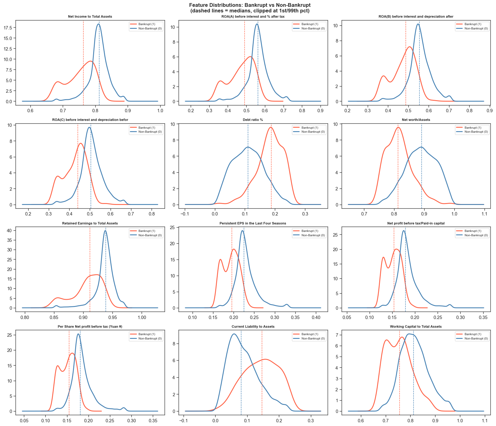

**LightGBM** was also considered due to its **leaf-wise tree growth strategy**, generally more efficient
than XGBoost's level-wise strategy in identifying informative splits. Given the dataset size (5,455
observations with more than 90 features), LightGBM's `num_leaves` parameter provides more flexible
control of model complexity than `max_depth`, allowing the model to efficiently capture complex feature
interactions.

### 3.2 Detailed preprocessing and modelling techniques *(ordered by estimated impact)*

#### 3.2.1 Class imbalance handling

**Threshold optimisation via the precision–recall curve.** Instead of using the default classification
threshold of 0.5, the optimal decision threshold was determined by searching for the probability cutoff
that maximises the F1 score on the validation set. Because F1 balances precision and recall, this
adjustment is particularly important in highly imbalanced classification problems where the positive
class is rare. In practice, this post-processing step substantially improved model performance,
**increasing the F1 score by 10–20 percentage points** compared with the default threshold.

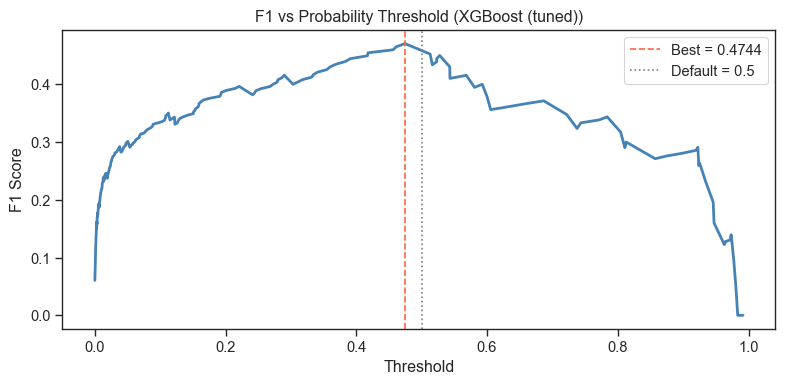
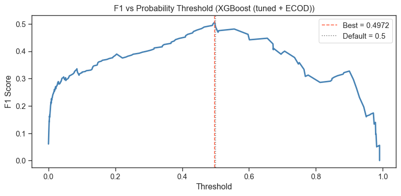

**Class weighting / cost-sensitive training.** Random Forest: `class_weight='balanced'`. XGBoost:
`scale_pos_weight = 31` (n_negative / n_positive ≈ 5285/170 ≈ 31). LightGBM: `is_unbalance=True`. These
approaches modify the effective contribution of minority-class samples during training, encouraging the
model to pay greater attention to bankruptcy observations.

**SMOTE** (Synthetic Minority Over-sampling Technique) generates synthetic minority-class samples through
k-nearest neighbour interpolation (k = 5) between existing minority observations (Chawla et al., 2002).
To avoid data leakage, **SMOTE was applied only within the training folds** of cross-validation —
oversampling the four training folds while the validation fold remained untouched.

**SMOTE-ENN.** After synthetic samples are generated, Edited Nearest Neighbors removes noisy or ambiguous
observations near class boundaries (Chawla et al., 2002; Wilson, 1972).

**SMOTE-Tomek links.** SMOTE oversampling followed by removal of Tomek links — pairs of observations from
different classes that are each other's nearest neighbours — cleaning overlapping class boundaries
(Chawla et al., 2002; Tomek, 1976).

**In practice, none of these methods improved the final results.** As noted by Kuhn & Johnson (2013),
SMOTE can inflate cross-validation performance but may fail to generalise to truly unseen data. Synthetic
samples interpolate between existing minority observations and fill the feature space around them; during
cross-validation these synthetic points can introduce similarity between training and validation folds,
leading to **overly optimistic F1 estimates**. When evaluated on an independent validation set, this
advantage often disappears while the precision penalty remains.

| Model | CV F1 | Val F1 |
|---|---|---|
| XGBoost (baseline) | 0.4715 | **0.4255** |
| SMOTE + XGBoost | 0.4773 | 0.3889 |
| SMOTE-ENN + XGBoost | 0.4726 | 0.3925 |
| XGBoost (top-30) | 0.4451 | 0.4082 |
| SMOTE + XGBoost (top-30) | 0.4726 | 0.3883 |
| SMOTE-ENN + XGBoost (top-30) | 0.4171 | 0.3765 |

*Figure 4: comparison between different combinations — SMOTE **raises** CV F1 while **lowering** Val F1,
which is precisely the inflation Kuhn & Johnson describe.*

#### 3.2.2 ECOD (Empirical Cumulative Distribution Function Outlier Detection)

ECOD was used as an unsupervised anomaly detection method to identify observations that deviate
significantly from the overall distribution. It computes outlier scores from empirical cumulative
distribution functions for each feature, allowing detection of extreme observations without strong
distributional assumptions (Zhao et al., 2020). The resulting anomaly score was converted into a binary
feature (`Is_outlier`).

Empirical analysis showed that **bankrupt firms were approximately 5.7 times more likely to be flagged as
outliers** than non-bankrupt firms, suggesting that abnormal financial ratios are strongly associated
with bankruptcy events. Incorporating this engineered feature increased the **validation F1 score from
0.4706 to 0.5060**.

#### 3.2.3 Missing-value flag engineering

Binary missing-value indicator variables were engineered. For each feature with a missing rate greater
than 5%, an additional binary variable was created to indicate whether the original value was missing.
This step was applied only when the **bankruptcy rate among missing observations was at least 1.2 times
higher** than that of non-missing observations, suggesting that the missingness was potentially
informative rather than random. This approach allows models — especially tree-based models — to **capture
missingness patterns as predictive signals**.

#### 3.2.4 Other data processing and modelling techniques

- **Missing value analysis:** columns with more than 50% missing values were removed.
- **Median imputation:** missing values filled using `SimpleImputer(strategy='median')`.
- **StandardScaler normalisation:** z-score applied primarily for Logistic Regression.
- **Yeo–Johnson power transformation:** applied to continuous features to reduce skewness and approximate
  normality; binary indicators were excluded and the transformation was **fitted only on the training
  data** (Yeo & Johnson, 2000).
- **Feature subset selection:** `STRONG_FEATURES` (21 features) and `ALL_FEATURES` (94 features),
  primarily evaluated in Random Forest experiments.
- **RFECV** (recursive feature elimination with cross-validation): iteratively removed the least important
  features (step = 5) using 5-fold CV with F1 as the evaluation metric. Showed limited improvement for
  tree-based models (Guyon et al., 2002).
- **Focal loss:** down-weights easy negative samples and forces the model to focus on difficult positives.
  Implemented in XGBoost through custom gradient and Hessian functions (Lin et al., 2017).
- **OOF stacking:** first-layer models (XGBoost, LightGBM, CatBoost) generated out-of-fold probability
  predictions using 5-fold StratifiedKFold; Logistic Regression served as the second-layer meta-learner.
- **Multi-seed averaging:** the same model trained with 10 different random seeds, predictions averaged to
  reduce variance and improve stability.

### 3.3 Hyperparameter tuning: Optuna Bayesian optimisation

All models were tuned using **Optuna** with the **Tree-structured Parzen Estimator (TPE)** sampler.
Unlike exhaustive grid search or uniform random search, TPE models the conditional probability
*P(hyperparameters | score)* and iteratively proposes more promising configurations based on the outcomes
of previous trials (Bergstra et al., 2011). This Bayesian framework concentrates the search on regions
more likely to yield improved performance, making it substantially more **sample-efficient**.

The tuning objective was to **maximise the F1 score of the minority class** using 5-fold stratified
cross-validation. Different sampling distributions were applied depending on parameter characteristics:
**log-uniform sampling** for scale-sensitive parameters such as learning rates and regularisation terms,
uniform sampling for tree-structure parameters.

Search budget allocated by model complexity: **XGBoost 200 trials · LightGBM 200 · CatBoost 100 ·
Random Forest 50**.

| Model | Trials | CV F1 (before) | CV F1 (after) | Val F1 (before) | Val F1 (after) | AUC-ROC |
|---|---|---|---|---|---|---|
| **XGBoost** | 200 | 0.3717 | 0.5435 | 0.4255 | **0.4706** | 0.9618 |
| LightGBM | 200 | 0.3560 | **0.5882** | 0.4324 | 0.4483 | 0.9605 |
| Random Forest | 50 | 0.4158 | 0.5329 | 0.4158 | 0.3944 | 0.9489 |
| CatBoost | 100 | — | — | — | 0.4286 | — |
| Logistic Regression | — | — | — | 0.4337 | 0.4337 | 0.9155 |

*Table 1: tuning results comparison*

**XGBoost** achieved the best validation performance after tuning, a Val F1 of 0.4706 — approximately a
**10.6% improvement** over the baseline.

**LightGBM** achieved the highest cross-validation F1 (0.5882) but a lower validation F1 (0.4483),
**suggesting a degree of overfitting during cross-validation**.

For **Random Forest**, validation performance slightly *declined* after tuning (0.4158 → 0.3944),
indicating the baseline configuration with `class_weight='balanced'` was already close to optimal.

**Logistic Regression** was not extensively tuned — its improvements are driven by threshold optimisation
rather than hyperparameter adjustment, since the model has few tunable parameters.

#### Best XGBoost configuration (200-trial TPE)

| Parameter | Search range | Best value |
|---|---|---|
| n_estimators | 100–800 | 578 |
| max_depth | 3–7 | 6 |
| learning_rate | 0.01–0.3 (log) | 0.030 |
| scale_pos_weight | 10–60 | 57.4 |
| gamma | 0.0–5.0 | 2.80 |
| min_child_weight | 1–20 | 17 |
| subsample | 0.5–1.0 | 0.636 |
| colsample_bytree | 0.5–1.0 | 0.624 |
| reg_alpha | 1e-4–10 (log) | 0.413 |
| reg_lambda | 1e-4–10 (log) | 0.918 |

The high `gamma = 2.80` and `min_child_weight = 17` indicate strong regularisation is needed to prevent
overfitting on only 136 positive training samples. The `scale_pos_weight = 57.4` — well above the natural
ratio of ~31 — suggests the model benefits from aggressively upweighting the minority class.

---

## 4. AI disclosure

**Claude Code (by Anthropic)** was used for code assistance, debugging, and exploratory analysis during
this project. The `/init` function was used at the beginning of development to provide the system with
project context — assignment background, feature descriptions from Kaggle, and relevant literature on
handling imbalanced datasets — allowing more context-aware technical suggestions.

Claude Code was also used to generate the initial project structure and code scaffolding. For certain
implementation details — ECOD outlier detection, SMOTE-based resampling, Predictive Power Score analysis,
and probability threshold optimisation — the methods were implemented by the author after reviewing the
relevant academic and technical references.

In some cases Claude Code suggested additional techniques, including missing-value indicator engineering,
stacking ensemble models, and the use of CatBoost as an alternative gradient boosting algorithm. These
suggestions were evaluated and selectively incorporated into the modelling experiments.

**All model selection decisions, experimental design, result interpretation, and report writing were
conducted by the author.**

---

## Reproducing this

The final notebook reads `train.csv` / `test.csv` from the repository root and writes `submission.csv`:

```bash
jupyter lab bankruptcy_ZhankaiZhang_v1.ipynb   # run top to bottom
```

Requires `xgboost`, `lightgbm`, `catboost`, `scikit-learn`, `imbalanced-learn`, `optuna`, `pyod` (ECOD),
`ppscore`, `pandas`, `numpy`, `matplotlib`, `seaborn`.

## Repository layout

```
.
├── README.md                             this file
├── report.md                             markdown draft of the report
├── bankruptcy_ZhankaiZhang_v1.ipynb      FINAL notebook — every number here comes from it
├── train.csv · test.csv                  Taiwan Economic Journal data (5,455 / 1,364)
├── submission.csv                        final submission (threshold 0.6004)
├── figures/                              figures above, exported from the final notebook
├── docs/                                 report PDF, notebook PDF, assignment brief, reference reading
└── archive/                              earlier notebook iterations and duplicate exports
```

The full report is in [`docs/Report_ZhankaiZhang.pdf`](docs/Report_ZhankaiZhang.pdf).

---

## References

- Bergstra, J., Bardenet, R., Bengio, Y., & Kégl, B. (2011). Algorithms for hyper-parameter optimization. *NeurIPS*, 24.
- Chawla, N. V., Bowyer, K. W., Hall, L. O., & Kegelmeyer, W. P. (2002). SMOTE: Synthetic minority over-sampling technique. *JAIR*, 16, 321–357.
- Chen, T., & Guestrin, C. (2016). XGBoost: A scalable tree boosting system. *KDD*.
- Guyon, I., Weston, J., Barnhill, S., & Vapnik, V. (2002). Gene selection for cancer classification using support vector machines. *Machine Learning*, 46(1–3), 389–422.
- Kuhn, M., & Johnson, K. (2013). *Applied Predictive Modeling*, Ch. 16: Remedies for Severe Class Imbalance.
- Lin, T. Y., Goyal, P., Girshick, R., He, K., & Dollár, P. (2017). Focal loss for dense object detection. *ICCV*.
- Tomek, I. (1976). Two modifications of CNN. *IEEE Transactions on Systems, Man, and Cybernetics*, 6, 769–772.
- Wilson, D. L. (1972). Asymptotic properties of nearest neighbor rules using edited data. *IEEE Transactions on Systems, Man, and Cybernetics*, 2(3), 408–421.
- Wetschoreck, F., Krabel, T., & Thiele, M. (2020). Predictive Power Score: A universal measure for predictive relationships. GitHub.
- Yeo, I. K., & Johnson, R. A. (2000). A new family of power transformations to improve normality or symmetry. *Biometrika*, 87(4), 954–959.
- Zhao, Z., Nasrullah, Z., & Li, Z. (2020). ECOD: Unsupervised outlier detection using empirical cumulative distribution functions. *ICDM*.
